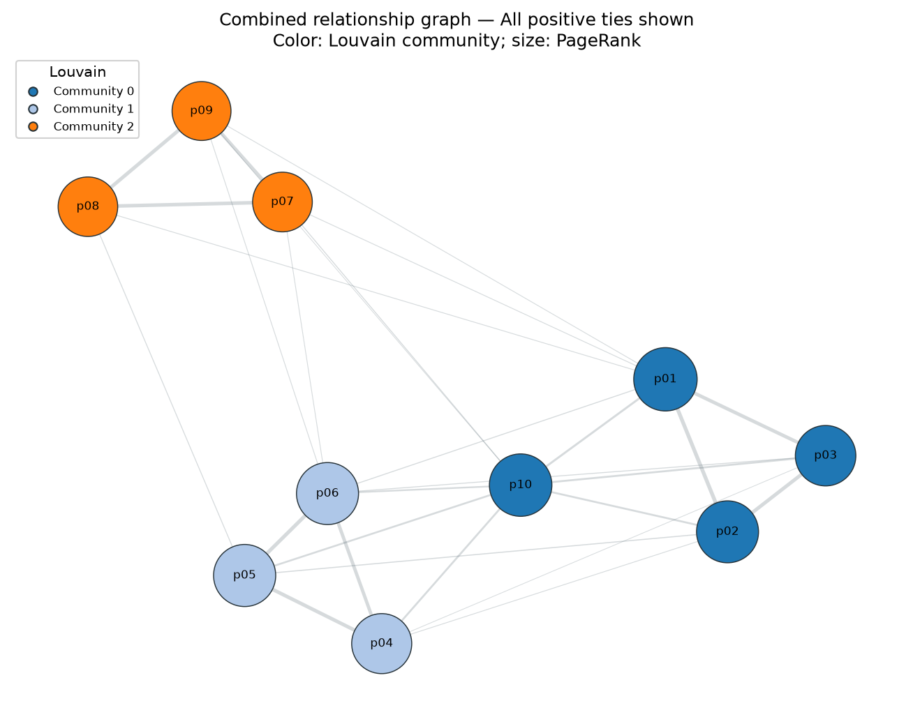

# LinkedIn Graph Intelligence

An offline-first Python demonstration that parses profile sections, stores validated records, and compares graph and feature analyses of a small fictional organisation. The default pipeline reads generated HTML fixtures through the real parser, then produces layer graphs, centrality and clustering comparisons, stability checks, plots, and a report generated from computed results.



## Data source and honesty statement

**The committed profiles are synthetic.** All fixture people, employers, schools, skills, posts, and interactions were generated for this task; every fixture page has a visible `SYNTHETIC` banner and `<meta name="synthetic" content="true">`. No real LinkedIn profile was fetched during development, and `make run` makes no network request. [`data/ground_truth.json`](data/ground_truth.json) contains designed fixture labels and is read only by validation, never extraction or ordinary analysis. Agreement with those labels says only whether the pipeline recovers the structure built into the fixtures.

| Adapter | Basic | Experience | Education | Skills | Interests | Activity | Source and limits |
| --- | --- | --- | --- | --- | --- | --- | --- |
| `fixture` (default) | Complete | Complete | Complete | Complete | Complete | Complete | Generated, visibly synthetic HTML; parsed, not copied directly from generator records. |
| `export` | Owner if supplied; connection stubs partial | Owner if dated positions supplied | Owner if supplied | Owner if supplied | Unavailable | Unavailable | Official export CSVs from the user's own account. Connection rows expose only name, company and position, so coverage stays false for missing fields. |
| `manual` | As supplied | As supplied | As supplied | As supplied | As supplied | As supplied | User-created schema JSON; validation rejects malformed records. |
| `live` (opt-in) | Publicly visible fields only | If visible | If visible | If visible | If visible | If visible | Code exists but was tested only with mocked HTTP. Robots disallow, an authwall, or missing sections yield false coverage and warnings. |

## Pipeline

```mermaid
flowchart LR
    A[Fixture HTML / own export / manual JSON / opt-in public page] --> B[Source adapter]
    B --> C[Schema validation and coverage]
    C --> D[profiles.json and flat CSV]
    D --> E[Organisation, education, skill, semantic, activity graphs]
    E --> F[Centrality and clustering comparisons]
    F --> G[Perturbation, nulls, ablation, weight sensitivity]
    G --> H[Career, activity, similarity]
    H --> I[graph.json, PNGs, CSV tables, generated report.md]
```



## Quick start

From the repository root, check that `python3 --version` reports Python 3.11 or newer, then create and activate a virtual environment. Installation uses plain pip. Once dependencies are installed, the fixture pipeline and tests run without internet access.

```bash
python3 --version
python3 -m venv .venv
source .venv/bin/activate
python -m pip install -r requirements.txt
make run
make test
```

`make install` performs the same virtual-environment creation and pip installation, with an explicit error if `python3` is older than 3.11. If `make` is unavailable, use these commands in the activated environment:

```bash
PYTHONPATH=src python -m lgi.cli run --source fixture
PYTHONPATH=src python -m pytest -q
```

Installation time depends on the package source and whether wheels are cached. The fixture run and test suite each took about 15 seconds in this workspace; other machines may differ. `make fixtures` regenerates the committed-size synthetic fixture set from the configured seed. `make clean` removes derived profiles and output files; `make run` recreates them.

## Repository and outputs

| Path | Purpose |
| --- | --- |
| [`src/lgi/`](src/lgi/) | CLI, schema, parser, adapters, analysis, plots, report generator, queue demo. |
| [`config.yaml`](config.yaml) | Seed, paths, edge rules, weights, k ranges, validation counts, live settings. |
| [`data/fixtures/`](data/fixtures/) | Committed synthetic HTML profiles; [`data/ground_truth.json`](data/ground_truth.json) is validation-only. |
| [`data/profiles.json`](data/profiles.json), [`data/profiles.csv/`](data/profiles.csv/) | Parsed profile records and section-specific flat CSV tables. |
| [`output/graph.json`](output/graph.json) | Node-link combined graph with metrics, role and cluster labels, all layers, bipartite graph and projections. |
| [`output/graph.png`](output/graph.png) | Combined-graph view, coloured by Louvain community and sized by PageRank. |
| [`output/`](output/) | Similarity heatmap, centrality ranking, rank-correlation heatmap, dendrogram, stability plot; `analysis.json` and `validation.json`. |
| [`output/report.md`](output/report.md), [`output/tables/`](output/tables/) | Generated report and CSVs for its tables. |
| [`notes.md`](notes.md) | Assumptions, HTTP behavior, queue design, storage and scale choices. |

## Analysis design

| Step | Methods and comparison |
| --- | --- |
| Graph layers | Overlapping shared past employer, education overlap, skill Jaccard versus TF-IDF cosine, offline semantic LSA versus TF-IDF cosine, observed engagement; manual weights versus equal-normalised combination. Person–skill bipartite graph and both projections are exported. |
| Sparse edge rule | An employer appearing in more than `org_ignore_employer_share: 0.8` of profiles is ignored in `G_org`. `G_skill` and `G_semantic` retain each profile's top `similarity_knn_k: 3` positive neighbours that meet their configured minimum weights, then symmetrise by union. Equal scores break by profile ID. These rules were selected without using ground-truth ARI. |
| Key people | Degree, weighted degree, betweenness, closeness, harmonic, eigenvector, PageRank, Katz, k-core, Burt constraint, effective size; Borda and mean reciprocal rank, Kendall and Spearman agreement, configurable role labels. |
| Clustering | Louvain, greedy modularity, label propagation, Girvan–Newman, spectral; TF-IDF KMeans and Ward, embedding KMeans, real sklearn HDBSCAN, NMF topics; silhouette/elbow k selection and pairwise ARI/NMI. Girvan–Newman uses unweighted edge betweenness to propose cuts, then weighted modularity on the same combined graph to choose one. |
| Validation | Exact top-three retention remains primary; mean overlap, nominal chance overlap, top-one retention, Kendall mean/median, and 5th–95th percentile rank intervals with actual min/max add context. Average ranks and inclusive cutoff ties are used. Nulls, ablation, weight draws, and synthetic ground-truth ARI/NMI are also reported. |
| Other findings | Rule-based seniority and transitions, education and skill co-occurrence, recorded-skill gaps and single-holder skills; post NMF topics, engagement comparison and topic/lexical consistency; cosine/Jaccard matrices and a k-nearest-colleagues graph. |

The configured reference month `2026-01` is the inclusive end month used for open-ended job overlap and career tenure; it is an analysis cutoff, not the latest activity date.

`requirements.txt` is the main dependency list with minimum versions. [`requirements-lock.txt`](requirements-lock.txt) records the tested Python 3.12 environment from `pip freeze`. `sentence-transformers` can be installed separately with pip if needed; only a model already available at the configured local path is considered. The default fallback is TF-IDF + TruncatedSVD (LSA), with no download.

## Results excerpt from the generated report

These values come from the committed synthetic **n=10** run in [`output/report.md`](output/report.md). The selected combined graph has **28** edges. They are illustrative, not statistically meaningful.

### Top key people

| Rank | ID | Person | Roles | Borda | Weighted degree | Betweenness | PageRank |
| --- | --- | --- | --- | --- | --- | --- | --- |
| 1 | p01 | Synthetic Persona 01 | hub, influencer | 88 | 2.627 | 0.000 | 0.109 |
| 2 | p10 | Synthetic Persona 10 | hub, bridge, influencer | 77 | 2.523 | 0.556 | 0.105 |
| 3 | p02 | Synthetic Persona 02 | hub | 66 | 2.497 | 0.000 | 0.103 |
| 4 | p05 | Synthetic Persona 05 | bridge, influencer | 64 | 2.480 | 0.111 | 0.104 |
| 5 | p06 | Synthetic Persona 06 | peripheral | 52 | 2.467 | 0.000 | 0.104 |

### Centrality method agreement

| Method A | Method B | Kendall tau | Spearman rho |
| --- | --- | --- | --- |
| degree | weighted_degree | 0.581 | 0.706 |
| betweenness | pagerank | 0.083 | 0.069 |
| pagerank | eigenvector | 0.689 | 0.770 |
| constraint | effective_size | -0.600 | -0.648 |
| closeness | harmonic | 0.511 | 0.648 |

### Stability summary

| Check | Draws | Exact top-three retention | Mean top-three overlap | Chance overlap | Top-one retention | Kendall tau mean | Kendall tau median | Cluster ARI median |
| --- | --- | --- | --- | --- | --- | --- | --- | --- |
| Edge perturbation | 1000 | 0.032 | 1.229 | 0.900 | 0.104 | 0.209 | 0.205 | — |
| Weight sensitivity | 100 | 0.410 | 2.540 | 0.900 | 0.470 | 0.739 | 0.750 | 1.000 |

The stability ranking uses weighted degree, weighted betweenness and PageRank, while the key-people ranking aggregates all centrality methods. The added overlap and top-one checks were introduced after the low exact top-three result; the primary metric is unchanged. In the generated run, topic consistency misses the designed mismatch **p09**, while lexical consistency flags it. The synthetic three-cluster ceiling and the Girvan–Newman result are reported in [`output/report.md`](output/report.md).

## Alternate inputs and larger fixtures

The following commands keep the committed default fixture HTML untouched; the requested larger set is generated in a temporary directory, while derived files under `data/profiles.*` and `output/` are overwritten. The generator was checked on **500** synthetic profile records; a full **500**-profile analysis has not been benchmarked and may be slow with the default validation counts.

```bash
PYTHONPATH=src .venv/bin/python -m lgi.cli run --source fixture --n 50
PYTHONPATH=src .venv/bin/python -m lgi.cli run --source fixture --n 500
```

For an official export of **your own account**, place `Profile.csv`, `Positions.csv`, `Education.csv`, `Skills.csv` and `Connections.csv` in `data/export/`, then run:

```bash
PYTHONPATH=src .venv/bin/python -m lgi.cli run --source export
```

For manual input, put one or more JSON files conforming to [`schema.py`](src/lgi/schema.py) in `data/manual/`. Optional `--anonymise` replaces only names and profile URLs with stable hashes; inspect or remove identifying free text yourself.

```bash
PYTHONPATH=src .venv/bin/python -m lgi.cli run --source manual --anonymise
```

The live adapter requires a user-supplied `urls.txt` with one public LinkedIn profile URL per line and an explicit acknowledgement. It may stop on `robots.txt`, HTTP 999, login/authwall responses, or other failures. It uses an honest project User-Agent, rate limits and backoff, and sends no login, cookies or account credentials. This mode has only mocked-HTTP tests; **it has never been run against LinkedIn here**. Public scraping can violate the site's terms of service; assess that before any use.

```bash
PYTHONPATH=src .venv/bin/python -m lgi.cli run --source live --i-understand-tos --urls urls.txt
```

## Evaluation checklist

| Criterion | Where addressed |
| --- | --- |
| Correct, clean extraction | [`schema.py`](src/lgi/schema.py), [`parse.py`](src/lgi/parse.py), exact fixture-to-parser tests, `data/profiles.json`. |
| Coverage of all sections | `coverage` and `warnings` per profile, [`coverage.csv`](output/tables/coverage.csv), the report's coverage table. |
| Analytical logic and value | Separate graph layers, centrality/clustering comparisons, [`validation.json`](output/validation.json), stability and ground-truth tables. |
| Simple, readable code | Source adapters behind one protocol, small typed modules under `src/lgi/`, config-driven parameters. |
| Practical documentation | This README, [`notes.md`](notes.md), generated [`report.md`](output/report.md), CLI and Makefile. |

## Limitations and provenance

The fixture graph and labels were designed for the demonstration, so validation against those labels does not establish real-world accuracy. The current ranking is sensitive to edge changes; the report exposes rank intervals, null comparisons, and ablations. Export connection stubs and live public pages cannot promise full coverage. Manual anonymisation does not scrub free text. Dense pairwise and repeated graph methods make large runs expensive; see [`notes.md`](notes.md) for scale changes. No real-person data, credentials or cookies are included in the committed default data.

**Author:** Mahdi Saieedi. **Licence:** not specified; this repository does not grant a licence beyond what applicable law permits.
